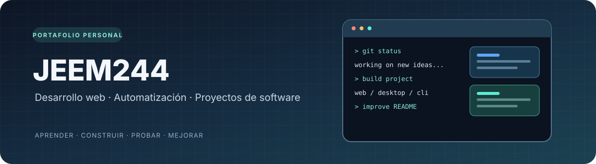

  

  
  
  

<h2 align="center">Hola, este es mi espacio de proyectos</h2>

Soy estudiante de Programación Web y aquí voy guardando proyectos que hago para practicar, resolver necesidades y aprender tecnologías nuevas. Algunos ya tienen funciones utilizables y otros siguen siendo experimentos.

## Proyectos principales

<table>
  <tr>
    <td width="50%" valign="top">
      
      <strong>YEXCEL</strong> 
      Registros diarios y exportación de datos a Excel.
    </td>
    <td width="50%" valign="top">
      
      <strong>Tibainv</strong> 
      Organizador personal de notas, listas y capturas de Tibia.
    </td>
  </tr>
  <tr>
    <td width="50%" valign="top">
      
      <strong>PREPA-AI</strong> 
      CLI de Windows para apoyo escolar; el motor local sigue pendiente.
    </td>
    <td width="50%" valign="top">
      
      <strong>DODO-OS</strong> 
      Laboratorio experimental de kernel x86-64.
    </td>
  </tr>
</table>

## Otros proyectos

| Proyecto | De qué trata |
|---|---|
| [D2 Soluciones Digitales](https://github.com/JEEM244/d2) | Sitio PHP/MySQL para catálogo de servicios y solicitudes |
| [DroidForge](https://github.com/JEEM244/apk) | Prototipo de escritorio para compilar APK debug e instalar por ADB |
| [NEXUS Security](https://github.com/JEEM244/divlad) | Prototipo de escritorio para visualizar revisiones de red |
| [NEXUS CLI](https://github.com/JEEM244/Termux) | Herramientas de diagnóstico local para Termux |
| [OMEGA Language](https://github.com/JEEM244/language) | Lenguaje y compilador experimental |
| [Home](https://github.com/JEEM244/home) | Organizador local de documentos escolares |
| [Centro Escolar](https://github.com/JEEM244/Prueba-Escuela) | Prototipo de plataforma escolar en Angular |
| [App Android](https://github.com/JEEM244/android-app) | Proyecto académico de cuatro actividades en Kotlin |

## Tecnologías que he usado

  
  
  
  
  
  
  
  
  
  

## Sobre los proyectos

Me gusta probar ideas diferentes: páginas web, sistemas para organizar datos, herramientas de consola y aplicaciones de escritorio. Dejo los repositorios en desarrollo marcados como prototipos para que se vea qué funciona y qué falta.

  <a href="https://github.com/JEEM244?tab=repositories">Ver todos mis repositorios</a>

